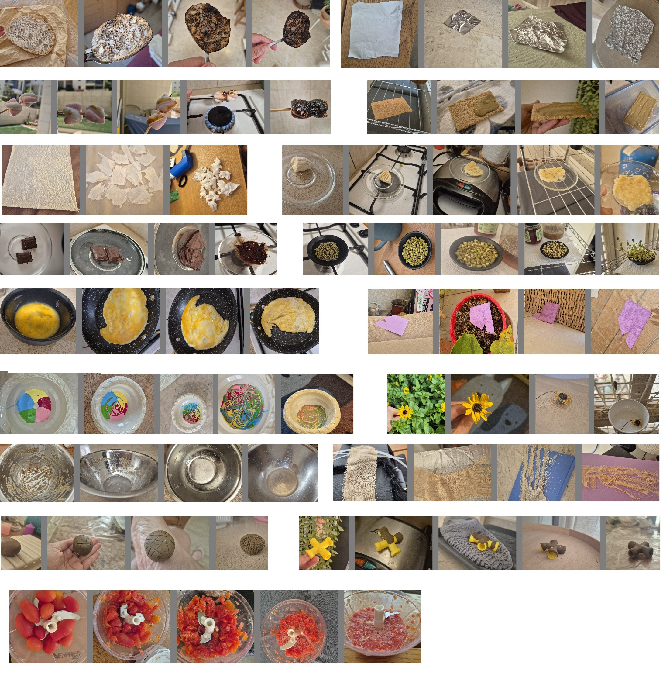

# MatMorph: A dataset for Visual Material-Transformation and Physical-State Recognition

## Download Sources:  [Hugging Face](https://huggingface.co/datasets/FlyingFrog/MatMorph_Visual_Material_Transformations_Dataset/tree/main)

MatMorph is a general-purpose dataset and benchmark for visual recognition of material and physical transformations.
MatMorph evaluates vision models' ability to recognize similarities and changes in materials and physical systems undergoing gradual changes in a zero-shot setting, without being restricted to specific processes, materials, or environments. For example, given a sequence of images showing metal gradually rusting, the model must identify which images represent the most similar states of the metal. Crucially, lighting, environmental conditions, and camera viewpoints vary between transformation steps, requiring models to recognize material states independently of imaging conditions and surrounding environments.
The benchmark covers diverse processes, including cooking, rusting, mixing, cleaning, coating, coating, sprouting, rotting, crumpling, melting, burning, folding, cracking and others. Each transformation is represented by a sequence of images (typically 4-10) showing the gradual progression of the process, with variations in object position, environment, lighting, and camera viewpoint between frames. Each image is accompanied by a PNG segmentation mask identifying the region undergoing transformation.
Most transformations involve movable objects photographed in different environments at successive stages. However, some involve stationary objects, such as walls and floors, where only lighting and camera viewpoint change. These sequences are provided separately in the Immobile folder.
The benchmark contains 184 transformation sequences comprising 1,050 images. Dataset loading, visualization, and evaluation scripts are provided in supporting_scripts.zip.

